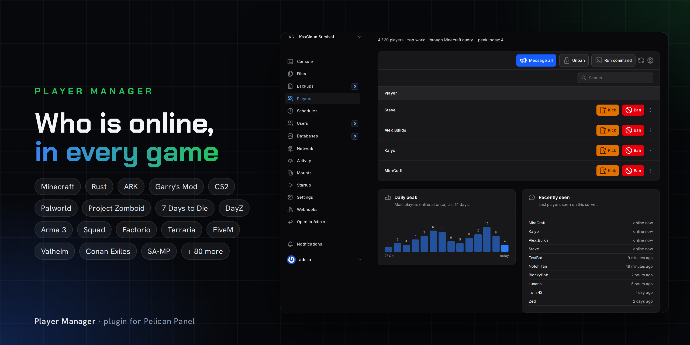
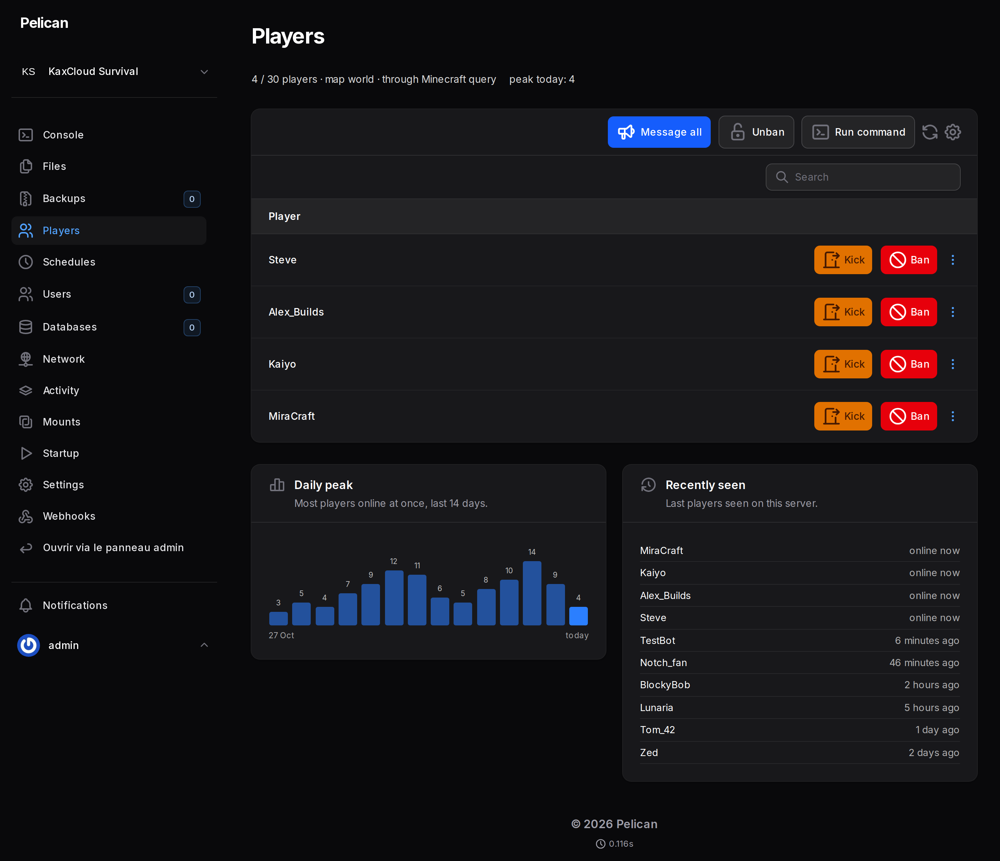
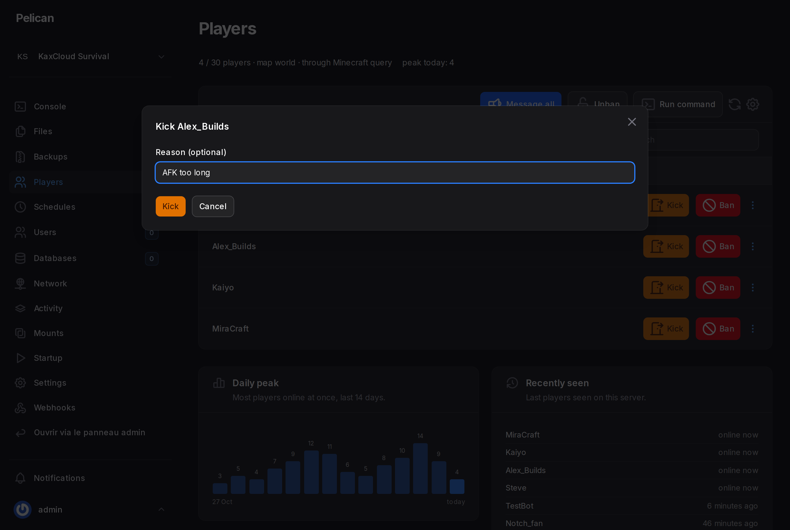
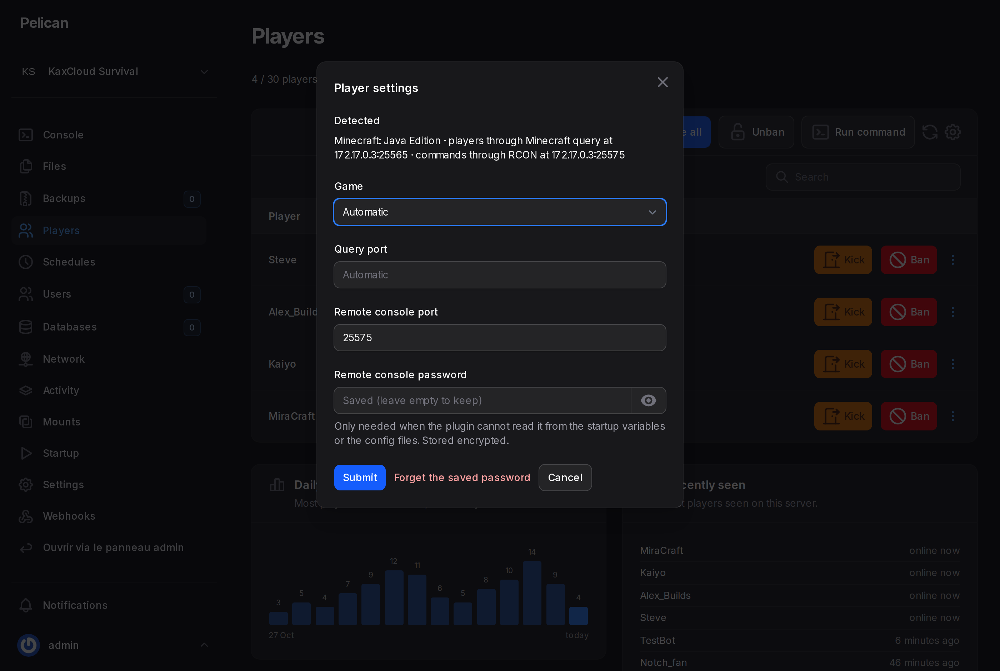
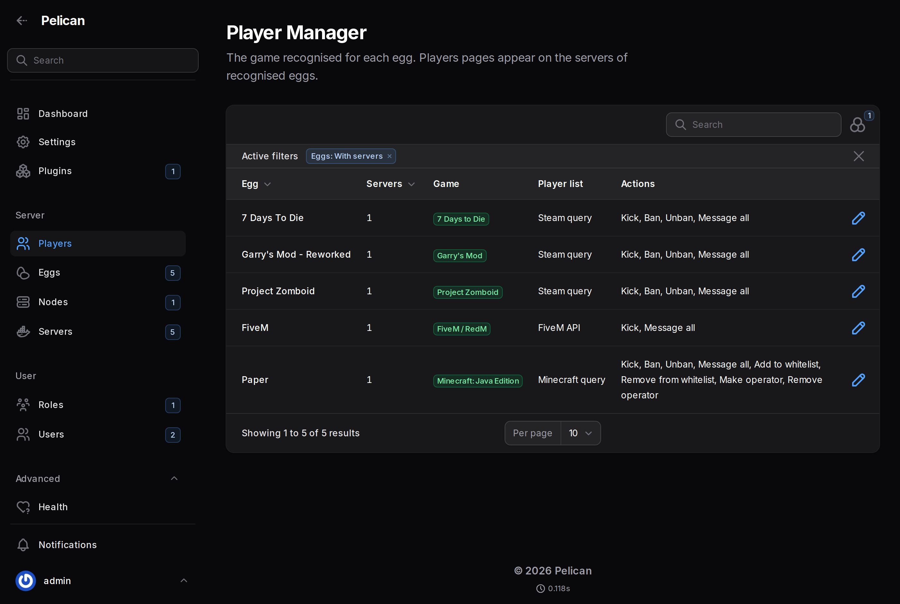

  

  
  
  
  

  <b>See who is playing, and deal with them, without leaving the panel.</b> 
  Player Manager adds a <b>Players</b> page to every game server of your <a href="https://pelican.dev">Pelican Panel</a>: kick, ban, message and whitelist, for 100+ games.

---

## ✨ Features

### 👥 Who is online, live
A **Players** page on every game server lists the connected players, with their **score, time played and ping** when the game shares them. It refreshes every 15 seconds, with search.

### 🔨 Act on players
**Kick** and **ban** with a reason, **unban**, **message everyone**, and for Minecraft **whitelist** and **operators**. Run **any command** and read the server's answer right under the list.

### 🔌 Works without setup
- **Listing players** uses the game's own query protocol (Steam A2S, Minecraft query...): nothing to configure, nothing written to the console.
- **Actions** go through the game's **remote console** (RCON, telnet, BattlEye...) when the plugin finds its port and password in the startup variables or config files. Otherwise they go through the **Pelican console**, as if typed in the Console page: most eggs pass console input to the game, so no password is needed at all.

### 🎮 100+ games, 17 protocols
The game is recognised from the egg, with the right ports and commands. See [the full list](#-supported-games).

### 📈 History
The **daily peak** over the last 14 days and the **players recently seen**, collected once a minute through queries only.

### 🔐 Permissions
Four subuser permissions in a **Players** section: **see** who is online, **manage** players (kick, ban, message...), **run commands**, and **configure** the game settings of the server. Owners and admins have all four.

### ⚙️ Per-server settings
Game, query port, remote console port and password can be set by hand when detection is not enough. Passwords are stored encrypted.

### 🛠️ Admin overview
An admin page lists every egg with the game recognised, how players are listed and the actions available. Correct the game of an egg in one click.

## 🎮 Supported games

| Game | Player list | Actions |
|---|---|---|
| **Minecraft: Java** (Paper, Purpur, Spigot, Fabric, Forge, NeoForge, modpacks...) | Minecraft query, or status ping (12 names) | kick, ban, unban, message, whitelist, op |
| **Minecraft: Bedrock** (BDS, Nukkit, PocketMine...) | Bedrock ping (count), names through the console | kick, message, allowlist, op |
| **Minecraft proxies** (Velocity, BungeeCord, Waterfall) | status ping | - |
| **Rust** | Steam query, WebRCON | kick, ban, unban, message |
| **ARK: Survival Evolved**, **PixARK** | Steam query, RCON | kick, ban, unban, message, whitelist |
| **ARK: Survival Ascended** | RCON | kick, ban, unban, message |
| **Garry's Mod**, **Counter-Strike 2 / Source**, **TF2**, **L4D 1 & 2**, **Insurgency**, **NMRiH**, **Black Mesa** and other Source games | Steam query, RCON `status` | kick, ban, unban, message |
| **CS 1.6**, **Sven Co-op** and other GoldSrc games | Steam query | kick, ban, unban, message |
| **Palworld** | RCON `ShowPlayers` | kick, ban, unban, message |
| **Project Zomboid** | Steam query | kick, ban, unban, message |
| **7 Days to Die** | Steam query, telnet `lp` | kick, ban, unban, message |
| **Conan Exiles** | Steam query, RCON | kick, ban, unban, message |
| **DayZ**, **Arma 3** | Steam query, BattlEye RCon | kick, ban, message |
| **Squad**, **Post Scriptum**, **Operation Harsh Doorstop** | Steam query, RCON | kick, ban, message |
| **Insurgency: Sandstorm** | Steam query | kick, ban, message |
| **V Rising** | Steam query | message |
| **Unturned** | Steam query | kick, ban, unban, message |
| **Empyrion** | Steam query | kick, ban, message |
| **Factorio** | RCON `/players` | kick, ban, unban, message, whitelist, admins |
| **Terraria** (vanilla, TShock, tModLoader) | console, TShock REST | kick, ban, message |
| **FiveM / RedM** | FiveM API | kick, message |
| **SA-MP / open.mp** | SA-MP query | kick, ban, message |
| **Multi Theft Auto** | ASE query | kick, ban, message |
| **OpenArena**, **Urban Terror**, **Wolfenstein: ET / ET Legacy**, **World of Padman**, **Xonotic**, **MOHAA** | Quake 3 status | kick, message |
| **Teeworlds / DDNet** | Teeworlds query | message |
| **Valheim**, **Enshrouded**, **Sons of the Forest**, **Soulmask**, **Icarus**, **The Isle**, **Arma Reforger**, **Assetto Corsa**, **Satisfactory** and 70+ other games with a query port | their query | - (commands through the console) |

Games without any query protocol or remote console (Among Us, Kerbal Space Program, Starbound...) are not shown a Players page.

### Protocols

Steam A2S, Source RCON, GoldSrc RCON, Minecraft query and status ping, Bedrock ping, Rust WebRCON, BattlEye RCon, telnet, Palworld REST, TShock REST, FiveM API, Quake 3 status and rcon, Teeworlds, Satisfactory API, SA-MP / open.mp, ASE (MTA) and Assetto Corsa.

Tested on live servers: Steam A2S (7 Days to Die, Garry's Mod, Project Zomboid), Minecraft query and ping, Source RCON (Minecraft, Factorio), Bedrock ping, FiveM API and the Pelican console channel (7 Days to Die, Project Zomboid). The other protocols follow their official documentation: if one misbehaves with your game, please [open an issue](https://github.com/MaitreAntho/pelican-player-manager/issues).

## 📦 Installation

1. In the admin area, open **Plugins** and import the plugin, or install it from the [Pelican Hub](https://hub.pelican.dev/plugins/player-manager).
2. Players pages appear on the servers of recognised eggs. Check what was recognised in **Server → Player Manager**.

Give subusers the **Players** permissions they need, and admin roles **Player Manager → View** (and **Update** to change the game of an egg).

## ⚙️ Settings

In **Plugins → Player Manager → Settings**:

| Setting | Default | |
|---|---|---|
| Query host | empty | Address the panel uses to reach game servers. Empty: the allocation IP, or the node address when the allocation listens on `0.0.0.0`. |
| Refresh every | 15 s | How often the player list updates. |
| Keep player history | on | Daily peak and recently seen players. |
| Keep history for | 30 days | |

## ❓ Troubleshooting

- **"The server does not answer"**: the server is stopped or still starting, or its query port is closed. Some games answer queries on another port: set it in the server's Player settings.
- **Minecraft shows up to 12 names**: set `enable-query=true` in `server.properties` to list everyone.
- **Bedrock shows nothing**: recent versions use `transport=nethernet`, which answers no query; set `transport=raknet`.
- **"Password refused"**: the remote console password the plugin found is not the one the game uses. Enter it in the server's Player settings.
- **Actions through the console do nothing**: the egg does not pass console input to the game (rare). Set up the game's remote console instead.

## 📄 License

[MIT](LICENSE) © MaitreAntho
